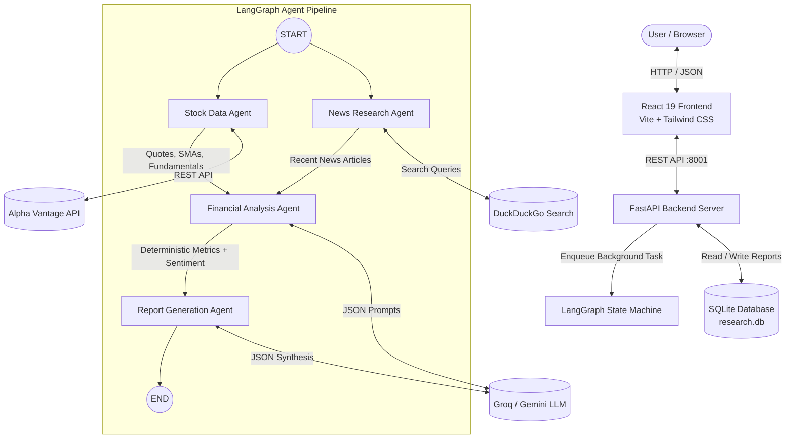
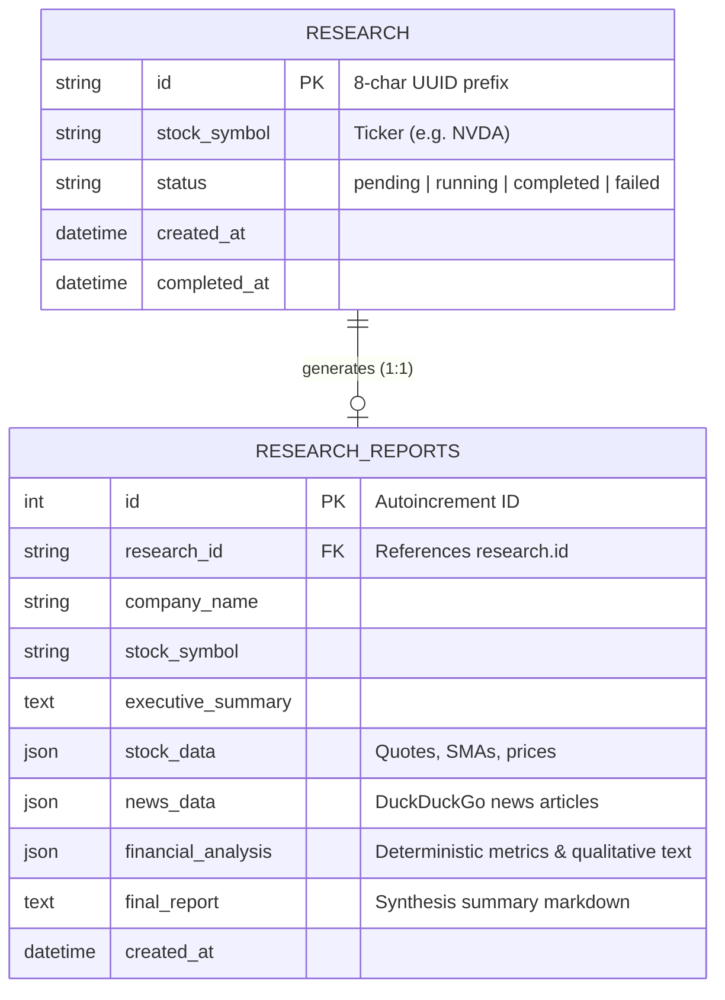

# MarketMind — AI Financial Research Multi-Agent Intelligence System

[](https://www.python.org/)
[](https://fastapi.tiangolo.com/)
[](https://github.com/langchain-ai/langgraph)
[](https://react.dev/)
[](https://vitejs.dev/)
[](https://tailwindcss.com/)
[](#license)

> An autonomous multi-agent financial intelligence and equity research platform coordinated with LangChain, LangGraph, FastAPI, and React. MarketMind ingests real-time market data and web news, performs deterministic quantitative financial mathematics, and synthesizes 9-section institutional-grade equity research dossiers.

---

## Table of Contents

- [Overview](#overview)
- [Key Features](#key-features)
- [Screenshots / Demo](#screenshots--demo)
- [Tech Stack](#tech-stack)
- [Project Architecture](#project-architecture)
- [Folder Structure](#folder-structure)
- [Prerequisites](#prerequisites)
- [Installation and Setup](#installation-and-setup)
- [Environment Variables](#environment-variables)
- [Running the Project](#running-the-project)
- [API Documentation](#api-documentation)
- [Database Schema](#database-schema)
- [Usage Examples](#usage-examples)
- [Testing](#testing)
- [Deployment](#deployment)
- [Troubleshooting](#troubleshooting)
- [Future Improvements / Roadmap](#future-improvements--roadmap)
- [Contributing](#contributing)
- [License](#license)
- [Contact / Author](#contact--author)

---

## Overview

### What the Project Does
**MarketMind** is a financial intelligence system that automates the workflow of equity research analysts. Given a public equity ticker symbol (e.g., `NVDA`, `AAPL`, `MSFT`), the application launches a directed multi-agent graph that:
1. Gathers daily stock time series and balance-sheet fundamentals from Alpha Vantage.
2. Scrapes and dedupes breaking market and earnings news via DuckDuckGo.
3. Computes deterministic technical indicators and volatility metrics directly in Python without LLM hallucination.
4. Coordinates qualitative risk, sentiment, and opportunity analysis using Large Language Models (Groq LLaMA 3.3 or Google Gemini).
5. Compiles and persists an institutional 9-section research dossier with transparent data/AI attribution tags and source citations.

### Problem It Solves
- **Eliminates Manual Data Gathering**: Analysts traditionally spend hours scraping news, pulling quotes, calculating moving averages, and drafting summaries.
- **Prevents LLM Number Hallucination**: Pure LLM financial analysis is notoriously prone to hallucinated math. MarketMind enforces a strict separation: all financial calculations (SMAs, returns, annualized volatility, 52-week proximity) are computed deterministically with Python math functions, while LLMs are strictly reserved for qualitative synthesis and contextual reasoning.
- **Differentiates Fact from AI Interpretation**: Every insight in the user interface is tagged as either `DETERMINISTIC MARKET DATA` or `AI AGENT SYNTHESIS`, preserving institutional integrity.

### Target Users
- Individual equity investors and retail traders seeking institutional-style research dossiers.
- Financial analysts looking for automated preliminary due diligence.
- Software engineers studying real-world LangGraph multi-agent orchestration and deterministic/LLM hybrid systems.

---

## Key Features

- **Multi-Agent Orchestration via LangGraph**:
  - **Stock Data Agent**: Fetches historical daily prices, 52-week highs/lows, P/E ratios, and market capitalizations.
  - **News Research Agent**: Queries DuckDuckGo for breaking business developments, earnings disclosures, and market discourse with automated URL deduplication.
  - **Financial Analysis Agent**: Executes Python-based quantitative mathematics (20-day & 50-day SMAs, annualized volatility, period returns) and passes structured context to the LLM for sentiment and risk scoring.
  - **Report Generation Agent**: Formats the final institutional equity dossier structured across 9 distinct analytical sections.
- **Pluggable LLM Providers**: Centralized LLM factory (`backend/utils/llm_factory.py`) supporting **Groq** (`llama-3.3-70b-versatile`) and **Google Gemini** (`gemini-2.0-flash`).
- **Parallel Agent Execution**: Stock Data and News agents execute in parallel branches from `START`, joining at the Analysis Agent node.
- **Real-Time Polling & Execution Tracking**: The frontend queries agent execution states asynchronously (`pending` $\rightarrow$ `running` $\rightarrow$ `completed`/`failed`) with per-agent activity messages.
- **Interactive Price Charting**: Interactive historical price visualization using Recharts.
- **Persistent Storage**: All research runs, agent metadata, and final reports are stored in SQLite via SQLAlchemy.
- **Dossier Archive & History**: Fast browsing and retrieval of previously generated research dossiers directly from the dashboard.

---

## Screenshots / Demo

<!-- TODO: Add application screenshots or demo GIF recordings here -->
| Dashboard & Ticker Search | Multi-Agent Execution Progress |
| :---: | :---: |
| *`TODO: Add dashboard screenshot`* | *`TODO: Add execution progress screenshot`* |

| Interactive Price Chart & News | 9-Section Research Dossier |
| :---: | :---: |
| *`TODO: Add chart screenshot`* | *`TODO: Add report view screenshot`* |

---

## Tech Stack

### Frontend
- **Framework**: React 19 (`react`, `react-dom`)
- **Build Tool & Dev Server**: Vite 8 (`@vitejs/plugin-react`)
- **Routing**: React Router 7 (`react-router-dom`)
- **Styling**: Tailwind CSS 4 (`@tailwindcss/vite`)
- **Charts**: Recharts 3 (`recharts`)
- **Icons**: Lucide React (`lucide-react`)
- **HTTP Client**: Axios (`axios`)
- **Animations**: Motion (`motion`)

### Backend
- **Framework**: FastAPI (Python 3.10+)
- **Server**: Uvicorn with standard workers (`uvicorn[standard]`)
- **Data Validation**: Pydantic v2 (`pydantic`)
- **Agent Coordination**: LangGraph (`langgraph`), LangChain Core (`langchain`, `langchain-core`, `langchain-community`)
- **LLM Integrations**:
  - Groq via `langchain-groq` (`ChatGroq`)
  - Google Gemini via `langchain-google-genai` (`ChatGoogleGenerativeAI`)
- **External Data Sources**:
  - Alpha Vantage API (REST via `requests`)
  - DuckDuckGo Search (`duckduckgo-search`)
- **Database / ORM**: SQLite with SQLAlchemy 2.0 (`sqlalchemy`)
- **Environment Management**: `python-dotenv`

---

## Project Architecture

The application implements a decoupled client-server architecture. The user submits a stock symbol from the React frontend, FastAPI schedules a background LangGraph pipeline, and the client polls for incremental state updates until final report completion.



### LangGraph Workflow Execution Details
1. **Parallel Extraction (`START`)**:
   - `stock_agent` queries Alpha Vantage for company overview metrics (`OVERVIEW`) and daily prices (`TIME_SERIES_DAILY`).
   - `news_agent` simultaneously queries DuckDuckGo for earnings and operational headlines.
2. **Deterministic Computation & Qualitative Analysis (`analysis_agent`)**:
   - Computes 20-day SMA, 50-day SMA, period return %, and annualized volatility % in pure Python.
   - Forwards computed metrics and news snippets to the selected LLM (`ChatGroq` or `ChatGoogleGenerativeAI`) for sentiment, risk, and catalyst categorization.
3. **Institutional Synthesis (`report_agent`)**:
   - Formats findings into 9 structured sections: Executive Summary, Company Overview, Stock Performance, Financial Analysis, News Analysis, Market Sentiment, Potential Risks, Opportunities, and Final Summary.
4. **Persistence & Retrieval**:
   - The compiled report is persisted to `research_reports` table, and the parent record in `research` table is marked `completed`.

---

## Folder Structure

```text
ai-financial-research/
├── backend/                        # FastAPI application & multi-agent pipeline
│   ├── agents/                     # LangGraph agent definitions
│   │   ├── __init__.py
│   │   ├── analysis_agent.py       # Agent 3: Deterministic math + qualitative LLM analysis
│   │   ├── report_agent.py         # Agent 4: 9-section report synthesis
│   │   ├── search_agent.py         # Agent 2: DuckDuckGo news retrieval
│   │   └── stock_agent.py          # Agent 1: Alpha Vantage stock data extraction
│   ├── api/                        # FastAPI route handlers
│   │   ├── reports.py              # GET /api/reports and GET /api/reports/{id}
│   │   ├── research.py             # POST /api/research, GET /api/research/{id}/status, GET /api/research/{id}
│   │   └── stocks.py               # GET /api/stocks/{symbol} direct quote endpoint
│   ├── database/                   # Database models & connection
│   │   ├── connection.py           # SQLAlchemy engine & session dependency
│   │   └── models.py               # Research & ResearchReport ORM entities
│   ├── graph/                      # LangGraph configuration
│   │   ├── __init__.py
│   │   ├── state.py                # ResearchState TypedDict definition
│   │   └── workflow.py             # StateGraph definition and execution wrapper
│   ├── tools/                      # External data provider clients
│   │   ├── alphavantage.py         # Alpha Vantage client with memory caching & error resilience
│   │   └── duckduckgo.py           # DuckDuckGo search tool wrapper
│   ├── utils/                      # Helper modules
│   │   ├── llm_factory.py          # Centralized LLM factory (Groq / Gemini)
│   │   └── prompts.py              # Structured system prompts for analysis & reporting
│   ├── main.py                     # FastAPI entry point, CORS, startup handlers
│   ├── requirements.txt            # Python dependencies
│   └── .env                        # Backend environment configuration
│
├── frontend/                       # React single-page application
│   ├── public/                     # Static assets
│   ├── src/
│   │   ├── components/             # Reusable UI components
│   │   │   ├── AgentProgress.jsx   # Live LangGraph agent status tracker
│   │   │   ├── Navbar.jsx          # Header navigation
│   │   │   ├── NewsCard.jsx        # DuckDuckGo news item display
│   │   │   ├── ReportSection.jsx   # 9-section dossier with AI/data distinction tags
│   │   │   ├── SearchBar.jsx       # Ticker input with quick-select buttons
│   │   │   └── StockChart.jsx      # Recharts price & volume chart
│   │   ├── pages/                  # Page views
│   │   │   ├── Dashboard.jsx       # Landing page, ticker search, historical dossier archive
│   │   │   └── Results.jsx         # Research view, live polling, dossier display
│   │   ├── services/
│   │   │   └── api.js              # Axios API service client
│   │   ├── App.jsx                 # Route definitions (/, /results/:id, /research/:id)
│   │   ├── index.css               # Global Tailwind CSS styles
│   │   └── main.jsx                # React root mount
│   ├── .env                        # Frontend environment variables
│   ├── package.json                # Frontend package configuration
│   └── vite.config.js              # Vite configuration (port 3000, API proxy)
│
├── package.json                    # Root package configuration
├── tsconfig.json                   # TypeScript compiler configuration (path aliases)
├── vite.config.ts                  # Root Vite configuration
└── README.md                       # Project documentation
```

---

## Prerequisites

Ensure you have the following installed on your machine:
- **Node.js**: `v18.0.0` or higher (`v20+` recommended)
- **Python**: `3.10` or higher (`3.11+` recommended)
- **Package Managers**: `npm`, `pnpm`, or `bun` for frontend; `pip` for Python
- **API Keys**:
  - [Alpha Vantage API Key](https://www.alphavantage.co/support/#api-key) (Free tier supported)
  - [Groq API Key](https://console.groq.com/keys) (Default and recommended) **OR** [Google AI Studio Gemini Key](https://aistudio.google.com/app/apikey)

---

## Installation and Setup

### 1. Clone the Repository
```bash
git clone https://github.com/your-username/ai-financial-research.git
cd ai-financial-research
```

### 2. Backend Setup

Create and activate a Python virtual environment:
```powershell
# On Windows (PowerShell)
python -m venv backend/venv
backend\venv\Scripts\Activate.ps1

# On macOS/Linux
python3 -m venv backend/venv
source backend/venv/bin/activate
```

Install backend dependencies:
```bash
pip install -r backend/requirements.txt
```

### 3. Frontend Setup

Install frontend dependencies from the project root or the `frontend/` directory:
```bash
cd frontend
npm install
cd ..
```

---

## Environment Variables

### Backend Configuration (`backend/.env`)

Configure your keys in `backend/.env`:

| Variable | Description | Example / Allowed Values |
| :--- | :--- | :--- |
| `LLM_PROVIDER` | Active LLM service provider | `groq` (recommended) or `gemini` |
| `GROQ_API_KEY` | API Key for Groq cloud inference | `gsk_...` |
| `GROQ_MODEL` | Groq chat model identifier | `llama-3.3-70b-versatile` |
| `GEMINI_API_KEY` | API Key from Google AI Studio | `AIza...` |
| `GEMINI_MODEL` | Google Gemini model identifier | `gemini-2.0-flash` |
| `ALPHA_VANTAGE_API_KEY` | API key for market quotes & time series | Your Alpha Vantage Key |
| `DATABASE_URL` | SQLAlchemy database connection string | `sqlite:///./research.db` |
| `FRONTEND_URL` | Allowed origin URL for CORS validation | `http://localhost:3000` |
| `PORT` | Backend server port | `8001` (default) |

> **Security Note:** Never commit actual API keys or credentials to public source control. Keep `.env` files listed in `.gitignore`.

### Frontend Configuration (`frontend/.env`)

| Variable | Description | Example |
| :--- | :--- | :--- |
| `VITE_API_BASE_URL` | Target URL for the backend API | `http://localhost:8001` (or leave empty if using Vite proxy) |

---

## Running the Project

### Running in Development Mode

Run the backend and frontend in separate terminal windows:

#### Terminal 1 — Backend (FastAPI):
> **Important:** Always launch Uvicorn from the **repository root directory** to allow absolute package imports (`backend.main:app`):
```powershell
# Windows
python -m uvicorn backend.main:app --host 0.0.0.0 --port 8001 --reload

# macOS/Linux
python3 -m uvicorn backend.main:app --host 0.0.0.0 --port 8001 --reload
```
The backend API will start at `http://127.0.0.1:8001` (Interactive Swagger docs available at `http://127.0.0.1:8001/docs`).

#### Terminal 2 — Frontend (Vite):
```bash
cd frontend
npm run dev
```
The React frontend will be accessible at `http://localhost:3000`.

### Production Build

To build the frontend for production:
```bash
cd frontend
npm run build
```
This outputs compiled static assets into `frontend/dist/`. You can preview the production bundle using:
```bash
npm run preview
```

---

## API Documentation

Interactive OpenAPI / Swagger documentation is generated automatically and accessible at `http://127.0.0.1:8001/docs`.

### Primary Endpoints Summary

#### 1. Start Research Workflow
- **Method**: `POST`
- **Route**: `/api/research`
- **Request Body**:
  ```json
  {
    "symbol": "NVDA"
  }
  ```
- **Response** (`200 OK`):
  ```json
  {
    "research_id": "a1b2c3d4",
    "symbol": "NVDA",
    "status": "running",
    "message": "LangGraph research workflow started for NVDA."
  }
  ```

#### 2. Get Real-Time Agent Execution Status
- **Method**: `GET`
- **Route**: `/api/research/{research_id}/status`
- **Response** (`200 OK`):
  ```json
  {
    "research_id": "a1b2c3d4",
    "status": "running",
    "data_available": false,
    "agents": {
      "stock_agent": {
        "status": "completed",
        "message": "Successfully retrieved stock data for NVDA (NVIDIA Corporation)",
        "updated_at": "2026-11-03T18:30:00.000000"
      },
      "news_agent": {
        "status": "completed",
        "message": "Gathered 8 verified news and disclosure sources.",
        "updated_at": "2026-11-03T18:30:01.000000"
      },
      "analysis_agent": {
        "status": "running",
        "message": "Calculating financial metrics & trend models for NVDA...",
        "updated_at": "2026-11-03T18:30:02.000000"
      },
      "report_agent": {
        "status": "pending",
        "message": "Awaiting quantitative analysis",
        "updated_at": "2026-11-03T18:29:58.000000"
      }
    }
  }
  ```

#### 3. Get Full Research Results & Report
- **Method**: `GET`
- **Route**: `/api/research/{research_id}`
- **Response** (`200 OK`): Returns complete stock data, news items, deterministic indicators, and 9-section report.

#### 4. List Historical Reports
- **Method**: `GET`
- **Route**: `/api/reports?limit=50`
- **Response** (`200 OK`): Array of historical `ResearchReport` records.

#### 5. Get Individual Report by ID
- **Method**: `GET`
- **Route**: `/api/reports/{report_id}`
- **Response** (`200 OK`): Retrieves report record by primary key `id` or `research_id`.

#### 6. Direct Stock Quote Endpoint
- **Method**: `GET`
- **Route**: `/api/stocks/{symbol}`
- **Response** (`200 OK`): Real-time price, overview, and historical time series without triggering an LLM run.

#### 7. System Health Check
- **Method**: `GET`
- **Route**: `/health`
- **Response** (`200 OK`):
  ```json
  {
    "status": "healthy",
    "service": "marketmind-backend",
    "llm_provider": "groq"
  }
  ```

---

## Database Schema

MarketMind persists analysis sessions using SQLAlchemy. The default database engine is SQLite (`research.db`).



### Table Definitions
1. **`research`**:
   - `id` (VARCHAR(64), Primary Key): Unique research identifier.
   - `stock_symbol` (VARCHAR(16)): Target ticker symbol.
   - `status` (VARCHAR(32)): Current state (`running`, `completed`, `failed`).
   - `created_at` / `completed_at` (DATETIME): Lifecycle timestamps.
2. **`research_reports`**:
   - `id` (INTEGER, Primary Key): Autoincrementing record identifier.
   - `research_id` (VARCHAR(64), Foreign Key): Unique reference to `research.id`.
   - `company_name` & `stock_symbol` (VARCHAR): Metadata attributes.
   - `stock_data` / `news_data` / `financial_analysis` (JSON): Structured outputs from the agent execution.
   - `executive_summary` / `final_report` (TEXT): Synthesized report text.

*Note: Database tables are initialized automatically upon application startup via `init_db()` in `backend/main.py`.*

---

## Usage Examples

1. **Open the Dashboard**:
   Navigate to `http://localhost:3000`. You will see the search bar, quick-select popular tickers (`NVDA`, `AAPL`, `MSFT`, `TSLA`, `AMZN`), and an archive of historical reports.
2. **Launch a Research Run**:
   Type a ticker symbol (e.g., `MSFT`) and click **Research**.
3. **Monitor Live Multi-Agent Progress**:
   The app redirects to `/results/{id}`. The execution card displays real-time progress as the Stock Data Agent, News Agent, Financial Analysis Agent, and Report Agent complete their work.
4. **Examine the 9-Section Dossier**:
   Review deterministic data (stock chart, moving averages, P/E ratio, market cap) side-by-side with AI analysis (sentiment rating, key risks, expansion catalysts, and final recommendation).
5. **Share or Revisit**:
   Click **Share** to copy the permanent URL (`/results/{research_id}`). The report remains saved in SQLite and can be viewed anytime from the dashboard.

---

## Testing

> **Status:** Automated unit and integration test suites are currently in development (`TODO`).

### Manual Endpoint Verification
You can manually test all endpoints using `curl` or the built-in Swagger UI:

```bash
# 1. Verify health check
curl http://127.0.0.1:8001/health

# 2. Trigger research workflow
curl -X POST http://127.0.0.1:8001/api/research \
  -H "Content-Type: application/json" \
  -d '{"symbol": "AAPL"}'

# 3. Check status (replace with returned research_id)
curl http://127.0.0.1:8001/api/research/<research_id>/status
```

---

## Deployment

### Production Requirements
- A Python 3.10+ runtime environment (e.g., Docker, AWS EC2, DigitalOcean Droplet, Railway).
- A static web host or CDN for the frontend bundle (e.g., Vercel, Netlify, Cloudflare Pages, NGINX).

### Build Frontend
```bash
cd frontend
npm run build
```
Upload the generated `frontend/dist` directory to your static hosting platform. Ensure `VITE_API_BASE_URL` points to your deployed backend URL.

### Run Backend with Production Process Manager
For production Linux environments, run Uvicorn behind Gunicorn or as a managed systemd service:
```bash
pip install gunicorn
gunicorn -w 4 -k uvicorn.workers.UvicornWorker backend.main:app --bind 0.0.0.0:8001
```

---

## Troubleshooting

### 1. `ImportError: attempted relative import with no known parent package`
- **Cause**: Running Uvicorn from inside the `backend/` directory (`cd backend && uvicorn main:app`).
- **Solution**: Always run Uvicorn from the **repository root**:
  ```powershell
  python -m uvicorn backend.main:app --host 0.0.0.0 --port 8001 --reload
  ```

### 2. `Alpha Vantage rate limit reached (5 calls/min on free tier)`
- **Cause**: Alpha Vantage's standard free tier allows a maximum of 5 API requests per minute and 25 per day.
- **Solution**: The client includes in-memory response caching (`CACHE_TTL_SECONDS = 3600`) to prevent duplicate requests for the same symbol. If limits are reached, wait 60 seconds before submitting another request, or upgrade to a premium Alpha Vantage tier.

### 3. `langchain_groq` or `duckduckgo_search` Missing Module Error
- **Cause**: Running in a Python environment where the dependencies have not been installed.
- **Solution**: Ensure your virtual environment is active, then install dependencies:
  ```bash
  pip install -r backend/requirements.txt
  ```

### 4. 404 Not Found on `/api/research/{id}/status`
- **Cause**: If the backend server restarts, in-memory active task mappings are reset.
- **Solution**: Completed reports are safely written to SQLite. If a background task was interrupted by a server restart, submit a new research request from the dashboard.

---

## Future Improvements / Roadmap

- [ ] `TODO`: Implement WebSocket / Server-Sent Events (SSE) streaming for token-by-token report generation and live agent log streaming.
- [ ] `TODO`: Add automated pytest coverage for LangGraph state transitions and deterministic math calculation functions.
- [ ] `TODO`: Add user authentication and organization-level research history filtering.
- [ ] `TODO`: Add export options (PDF, Markdown, Excel data tables) for generated equity dossiers.
- [ ] `TODO`: Support optional PostgreSQL connection pooling for multi-user production environments.

---

## Contributing

Contributions are welcome! Please follow these steps:
1. **Fork** the repository.
2. **Create a Feature Branch**:
   ```bash
   git checkout -b feature/amazing-feature
   ```
3. **Commit Your Changes**:
   ```bash
   git commit -m "Add amazing feature"
   ```
4. **Push to Your Branch**:
   ```bash
   git push origin feature/amazing-feature
   ```
5. **Open a Pull Request**.

---


